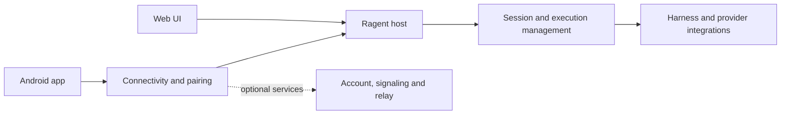

# Architecture

> Service ownership, security boundaries, and deployment instructions still
> require release verification.

Ragent consists of an execution host and client interfaces. The host manages
sessions and integrates agent runtimes; clients render work and send requests.
Account, signaling, and relay services support remote connectivity in applicable
deployments. Their public-source and self-hosting boundaries are still being
established.

## Code navigation

- `chat/session-manager.mjs` coordinates session work and runtime execution.
- `chat/` includes routes, event processing, history, and session services.
- `lib/` contains configuration, runtime, provider, and platform integration.
- `static/chat/` implements the web workbench.
- `docs/frontend-chat-architecture.md` describes the web workbench's state and
  rendering boundaries.
- `android/core/` contains protocol, connectivity, authentication, storage, and
  presentation building blocks; `android/feature/` contains app features.
- `p2p/` contains the Go host and signaling code; `accounts/` and
  `infrastructure/turn-broker/` contain generic service implementations.
- `tests/` and Android module test directories contain automated checks.

Consult the release's tested-platform matrix before relying on a feature. A
successful build does not by itself verify a deployed account service, model
provider, remote network path, or a particular platform installer.
